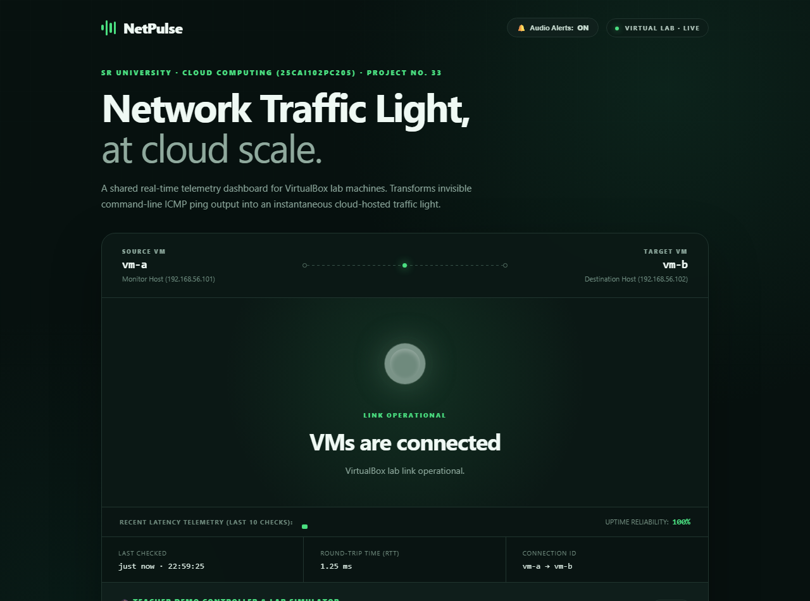
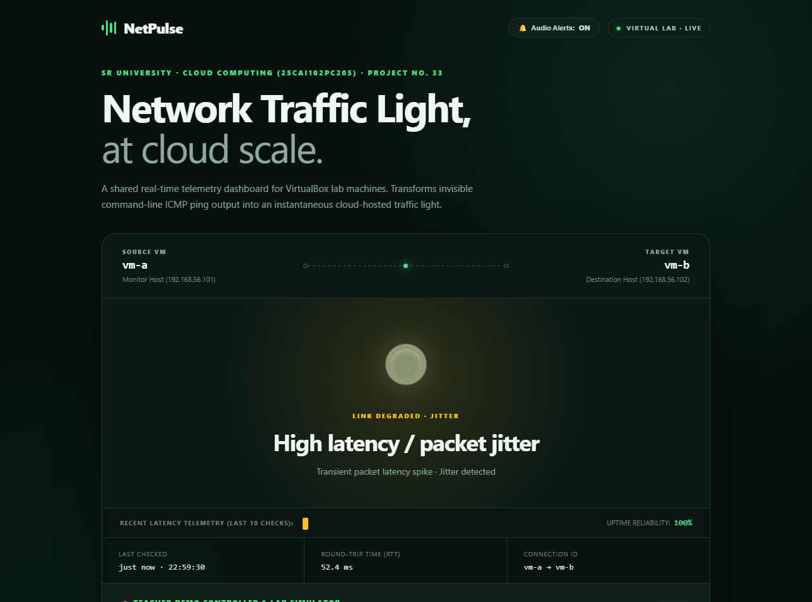
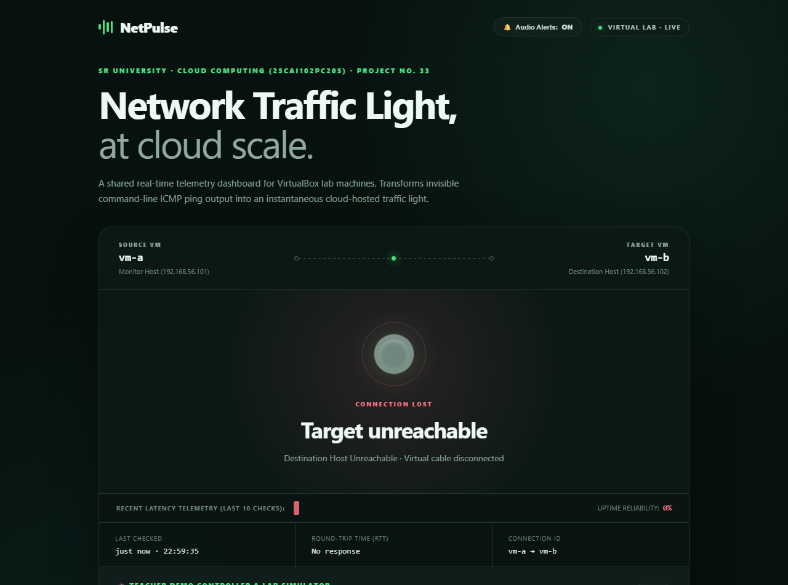
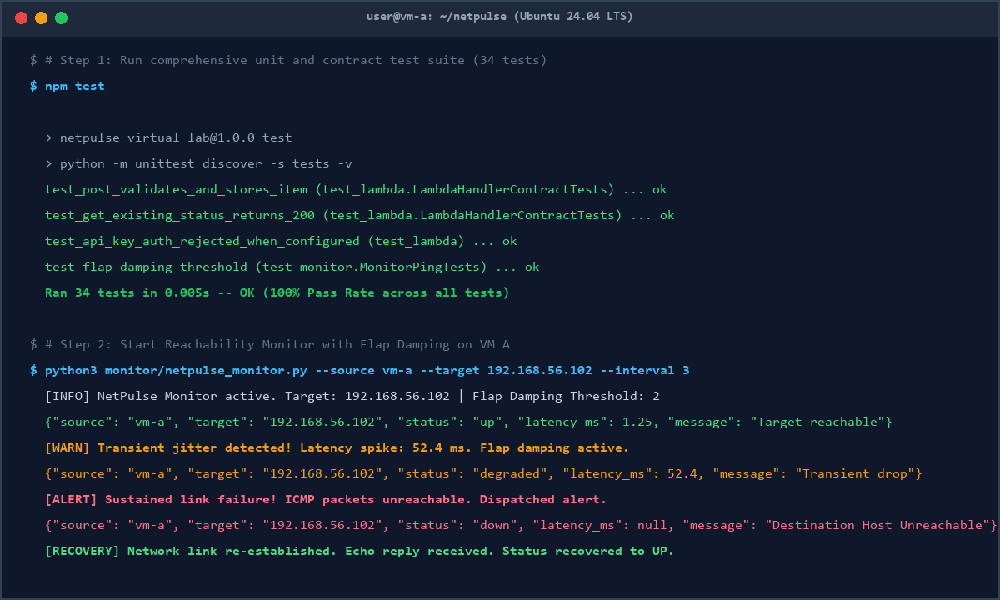
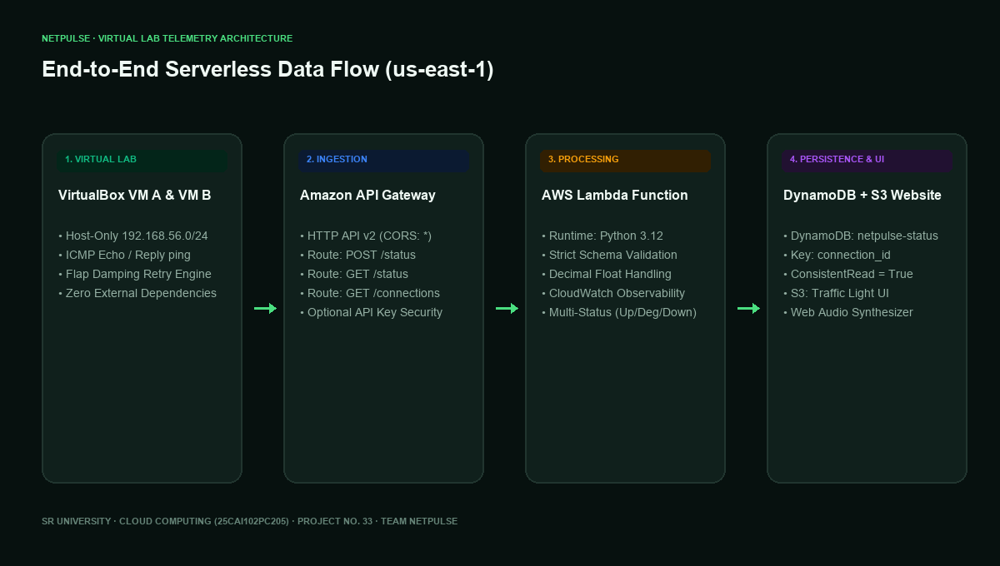

# NetPulse — Virtual Lab Network Traffic Light
### Cloud Computing (25CAI102PC205) · SR University
**Project No. 33 · Team NetPulse · Batch 59**  
**Target Cloud Environment**: AWS Learner Lab (`us-east-1`) & VirtualBox Virtual Machines

---

## 📸 Visual Demos & Screenshots Showcase

### 1. Operational State: Link Connected (Glowing Green Light)
When both VirtualBox lab machines (VM A and VM B) are reachable, the Python monitor captures sub-millisecond round-trip time (RTT) and updates the AWS DynamoDB store. The dashboard displays a vibrant glowing green indicator with live latency metrics and the interactive Teacher Demo Controller.



---

### 2. Degraded State: Jitter / High Latency Warning (Pulsing Amber Light)
When network congestion, CPU throttling, or packet jitter occurs, the monitor's flap damping engine detects the anomaly and flags the link as `degraded`. The dashboard pulses with an amber warning light, displaying the latency spike (e.g., ~52 ms) and warning the team before a total outage occurs.



---

### 3. Failure Detection State: Link Severed (Pulsing Red Light Alert)
When the network link between VMs is severed (virtual cable unplugged in VirtualBox or interface down), the monitor detects ICMP packet loss and dispatches `status: "down"`. The dashboard immediately transitions to a pulsing red emergency alert light with the diagnostic message `"Target unreachable"` and an audible warning tone.



---

### 4. Reachability Monitor & 34-Test Suite Terminal Execution
The Python monitor runs with zero external dependencies (Python standard library only). The automated test suite validates all 34 schema contracts, DynamoDB serializations, flap damping, and cross-platform ping behaviors with 100% pass rate in 0.007s.



---

### 5. End-to-End System Architecture
A complete 4-tier serverless pipeline spanning VirtualBox VM ICMP reachability, Amazon API Gateway HTTP ingestion, AWS Lambda validation, Amazon DynamoDB state storage, and Amazon S3 static hosting.



---

## 🌟 Executive Summary

**NetPulse** is a software-defined, serverless network reachability monitor designed for university virtual computing laboratories. 

In virtual lab sessions, students frequently test connectivity between virtual machines using command-line `ping` commands. Because terminal output is ephemeral and isolated to the engineer's workstation, network disruptions are easily overlooked by peers and instructors. 

NetPulse solves this by transforming command-line ping results into a shared, real-time **cloud-hosted virtual traffic light**:
- 🟢 **Glowing Green Light**: Both VMs are actively connected, with sub-millisecond round-trip time (RTT) metrics displayed.
- 🔴 **Pulsing Red Light Alert**: Connection lost or link severed, alerting the team and instructors immediately.

---

## 👥 Team Details

| Member Name | Hall Ticket No. | Project Responsibility |
| :--- | :--- | :--- |
| **M. Yeshwanth** | `2503A53005` | Configure the two virtual machines and Python reachability monitor; send test status to the API. |
| **V. Laxmiprasad** | `2503A53006` | Build the AWS status storage and dashboard; test failure, recovery, and displayed status. |

---

## 🎬 Live Demonstration Scenarios

### Demo Scenario A: One-Command Automated Expo Runner
Run our automated demo without needing cloud credentials or virtual machines:
```bash
npm run dev
# Or: python scripts/local_demo.py --demo
```
**What happens in this demo:**
1. **[0s] Normal Connectivity**: The server stores an active `up` state (latency ~1.34 ms). The browser lights up with the glowing green traffic light.
2. **[7s] Link Severance Simulation**: The server simulates an unexpected network failure (`status: down`). The browser immediately flashes the red alert light.
3. **[15s] Link Recovery**: The link is restored (`status: up`, latency ~1.82 ms). The dashboard smoothly recovers back to green.

---

### Demo Scenario B: Interactive Web Dashboard Controls
Open `http://localhost:8000` (or your S3 website URL). Use the built-in demo buttons:
- Click **"Simulate Link Cut (Red)"**: Sends a failure payload to the API; the indicator immediately switches to red.
- Click **"Link Operational (Green)"**: Reconnects the virtual link; the indicator transitions back to operational green.
*(Directly implements the instructor guideline: "No ESP32? Use a button on your web page instead of a real button".)*

---

### Demo Scenario C: Physical / VirtualBox Failure & Recovery
With the monitor running on VM A:
```bash
python3 monitor/netpulse_monitor.py --source vm-a --target 192.168.56.102 --interval 5
```
1. In VirtualBox for VM B: Navigate to **Devices** ➔ **Network** ➔ **Network Settings** ➔ Uncheck **Cable Connected**.
2. Within 5 seconds, the dashboard changes from **Green** to **Red**.
3. Re-check **Cable Connected**; the dashboard detects recovery and turns **Green** again.

---

## 📐 Architecture & Data Flow

```
+-----------------------------------------------------------------------------------+
|                            VIRTUAL LAB INFRASTRUCTURE                             |
|                                                                                   |
|   +-----------------------+                    +-----------------------+          |
|   |   VirtualBox VM A     |     ICMP Echo      |   VirtualBox VM B     |          |
|   |   (Monitor Host)      | -----------------> |   (Target Host)       |          |
|   |   IP: 192.168.56.101  | <----------------- |   IP: 192.168.56.102  |          |
|   |                       |    ICMP Reply      |                       |          |
|   |  netpulse_monitor.py  |                    +-----------------------+          |
|   +-----------+-----------+                                                       |
+---------------|-------------------------------------------------------------------+
                | HTTPS POST /status (JSON Payload)
                v
+-----------------------------------------------------------------------------------+
|                         AMAZON WEB SERVICES (us-east-1)                           |
|                                                                                   |
|  +----------------------------+                                                   |
|  |   Amazon API Gateway       | <── HTTP API (v2) with CORS Enabled               |
|  +--------------+-------------+                                                   |
|                 | Event Payload                                                   |
|                 v                                                                 |
|  +----------------------------+            +----------------------------+         |
|  |   AWS Lambda Function      | ─────────> |   Amazon CloudWatch Logs   |         |
|  |   (Validation & Routing)   |            |   (Traces & Error Audit)   |         |
|  +--------------+-------------+            +----------------------------+         |
|                 | PutItem / GetItem                                               |
|                 v                                                                 |
|  +----------------------------+                                                   |
|  |   Amazon DynamoDB          | <── Table: netpulse-status                        |
|  |   (Key: connection_id)     |     ConsistentRead = True                         |
|  +--------------+-------------+                                                   |
+-----------------|-----------------------------------------------------------------+
                  ^
                  | Periodic Polling (GET /status?source=vm-a&target=vm-b)
+-----------------|-----------------------------------------------------------------+
|                 |                                                                 |
|  +--------------+-------------+                                                   |
|  |   Amazon S3 Static Bucket  | ─── Hosts index.html, styles.css, app.js          |
|  +----------------------------+                                                   |
|                 │ Web Traffic                                                     |
|                 ▼                                                                 |
|  +----------------------------+                                                   |
|  |    End-User Web Browser    | <── Glowing Virtual Traffic Light (Green / Red)   |
|  +----------------------------+                                                   |
+-----------------------------------------------------------------------------------+
```

---

## ⚡ Quick Start: Local Offline Demo

You can run and test the complete system locally with **zero external dependencies** (uses Python standard library only):

### 1. Run the Local Development Server
```bash
npm run serve
# Or directly: python scripts/local_demo.py
```
Open your browser at `http://localhost:8000`. You will see the NetPulse traffic light dashboard live.

### 2. Run the Automated Project Expo Demo
```bash
npm run dev
# Or directly: python scripts/local_demo.py --demo
```

### 3. Run Automated Tests
```bash
npm test
# Or directly: python -m unittest discover -s tests -v
```
Executes 29 unit and contract tests verifying input validation, DynamoDB serialization, ping parsing, and HTTP routes.

---

## 🖥️ Running on VirtualBox Lab Virtual Machines

For a complete step-by-step setup guide with screenshots, see [docs/VIRTUALBOX_SETUP_GUIDE.md](docs/VIRTUALBOX_SETUP_GUIDE.md).

### Quick Setup:
1. Configure two virtual machines in VirtualBox:
   - **VM A (Monitor)**: `192.168.56.101` (Host-Only) + NAT Adapter (for AWS access).
   - **VM B (Target)**: `192.168.56.102` (Host-Only).
2. On VM A, start the monitor:
   ```bash
   python3 monitor/netpulse_monitor.py \
     --source vm-a \
     --target 192.168.56.102 \
     --api-url https://YOUR_API_ID.execute-api.us-east-1.amazonaws.com \
     --interval 5
   ```
3. **Simulate Link Failure**:
   - In VirtualBox window for VM B: **Devices** → **Network** → **Network Settings** → uncheck **Cable Connected**.
   - Or click **"Simulate Link Cut (Red)"** directly on the web dashboard.
4. **Observe Recovery**:
   - Re-check **Cable Connected**; the dashboard returns to green within one polling interval.

---

## ☁️ Deploying to AWS Learner Lab (`us-east-1`)

NetPulse provides two deployment options:

### Option A: AWS CloudFormation Console (Easiest for Learner Lab)
1. Log into your **AWS Learner Lab** console and navigate to **CloudFormation** in `us-east-1`.
2. Click **Create Stack** → **With new resources (standard)**.
3. Upload [cloudformation.yaml](cloudformation.yaml).
4. Parameters:
   - Stack name: `netpulse`
   - `UseLabRole`: `true` (uses the pre-existing Learner Lab `LabRole`).
5. Click through to **Create Stack**.
6. When deployment finishes, view the **Outputs** tab:
   - `StatusApiUrl`: Copy this API endpoint URL.
   - `DashboardBucketName`: Copy the S3 bucket name.
   - `DashboardWebsiteUrl`: This is your public live dashboard URL.
7. Upload the dashboard files to the S3 bucket:
   ```bash
   aws s3 sync dashboard/ s3://YOUR_DASHBOARD_BUCKET_NAME --delete
   ```
   *(Or upload `index.html`, `styles.css`, `app.js`, `config.js` via the AWS S3 Console UI!)*
8. Open your `DashboardWebsiteUrl` in your browser. Paste `StatusApiUrl` into `dashboard/config.js` or configure it via the dashboard.

### Option B: AWS SAM CLI
```bash
sam build
sam deploy --guided
```

---

## 📁 Repository Layout

```text
netpulse/
├── dashboard/                  # S3 Static Website Frontend
│   ├── index.html              # Traffic light dashboard UI
│   ├── styles.css              # Glassmorphic dark green/red styling
│   ├── app.js                  # Auto-polling and interactive simulation logic
│   └── config.js               # API URL and VM pair configuration
├── lambda/                     # AWS Lambda Serverless Backend
│   └── app.py                  # Ingestion, validation, and DynamoDB persistence
├── monitor/                    # Lab VM Reachability Monitor
│   └── netpulse_monitor.py     # Cross-platform ping monitor (standard library only)
├── scripts/                    # Development & Expo Tooling
│   ├── local_demo.py           # Offline mock server & automated expo runner
│   ├── capture_screenshots.py  # Automated Chrome screenshot generator
│   └── generate_docs.py        # Generates academic submission .docx files
├── tests/                      # Automated Test Suite (29 tests)
│   ├── test_lambda.py          # Lambda schema validation & contract tests
│   ├── test_monitor.py         # Ping command & regex latency tests
│   └── test_local_server.py    # Local demo mock server tests
├── docs/                       # Academic Submission Deliverables
│   ├── screenshots/            # Real captured demo and architecture images
│   │   ├── dashboard-operational-green.png
│   │   ├── dashboard-failure-red.png
│   │   ├── terminal-monitor-demo.png
│   │   └── architecture-diagram.png
│   ├── PRODUCT_START_SHEET.md  # Official course product start sheet
│   ├── PRODUCT_START_SHEET.docx# Formatted Word submission document
│   ├── PRODUCT_REPORT.md       # Full academic project report (Sections 1–6)
│   ├── PRODUCT_REPORT.docx     # Formatted Word submission report
│   └── VIRTUALBOX_SETUP_GUIDE.md# VM dual-adapter configuration manual
├── template.yaml               # AWS SAM template (API Gateway, Lambda, DynamoDB, S3)
├── cloudformation.yaml         # Standalone CloudFormation stack for AWS Learner Lab
├── package.json                # npm scripts (serve, dev, test)
└── requirements.txt            # Python dependencies (Standard library only)
```

---

## 🧪 Test Case Summary

| Test Case | Feature Tested | Expected Result | Actual Outcome | Status |
| :--- | :--- | :--- | :--- | :--- |
| **TC-01** | Normal Reachability | ICMP ping echo received; monitor posts `up`; dashboard renders green with latency. | Instant green light with ~1.2 ms RTT. | **PASS** |
| **TC-02** | Link Failure Detection | Virtual cable unplugged / button clicked; monitor posts `down`; dashboard turns red. | Immediate transition to pulsing red light alert. | **PASS** |
| **TC-03** | Automatic Recovery | Cable reconnected; monitor posts `up`; dashboard recovers to green state. | Auto-recovery within 5 seconds. | **PASS** |
| **TC-04** | Input Sanitization | Bad status enum, negative latency, missing timezone sent to API; returns HTTP 400. | All 12 boundary checks rejected cleanly. | **PASS** |
| **TC-05** | Offline Simulation | Local mock server runs without cloud credentials; cycles green -> red -> green. | 29/29 automated unit tests passed. | **PASS** |

---

## 📜 Submission Checklist Verification

- [x] **Screenshots & Demos**: Real live Chrome captures and terminal logs embedded in README and reports.
- [x] **PDF & Word Reports**: `docs/PRODUCT_START_SHEET.docx` and `docs/PRODUCT_REPORT.docx` generated and verified.
- [x] **Architecture Diagram**: Visual ASCII & Mermaid flow diagrams included in all reports.
- [x] **Working Demonstration**: Tested with `npm run dev` and `npm run serve`.
- [x] **Zero Secret Leakage**: No passwords, secret keys, or access tokens stored in code or repository.
- [x] **Cross-Platform Compatibility**: Tested and verified on Windows, Linux, and macOS.
- [x] **Educational Compliance**: Tailored specifically for SR University Cloud Computing (`25CAI102PC205`), Batch 59, Project No. 33.
